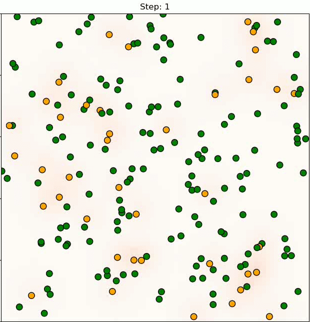

# Reinforcement Learning for Antibiotic Stewardship in a Simulated Hospital Ward with Coupled Within-Host and Transmission Dynamics

**Hsuan-Wei Lee**  
College of Health, Lehigh University, Bethlehem, PA, USA

**Te-Chun Liu**  
Department of Information Management, National Taiwan University of Science and Technology, Taipei, Taiwan

**Target journal:** *Computers in Biology and Medicine* (submission planned for November 2026).

**arXiv:** [Preprint link to be updated](https://arxiv.org/).

This repository contains the simulated hospital ward environment and reinforcement learning implementation developed to investigate antibiotic stewardship under antimicrobial resistance (AMR). It couples within-host bacterial competition dynamics with ward-level transmission dynamics and employs PPO-based prescriber agents to study the effects of antibiotic treatment decisions on patient outcomes and resistance development.



*Figure: Demonstration of the simulated hospital ward environment, illustrating patient-level infection dynamics and antibiotic stewardship interactions.*

> **Note:** This demonstration is provided for illustration purposes. The displayed environment and agent behavior may reflect an earlier experimental configuration and may not fully represent the latest implementation or final manuscript results.

---

## Prerequisites & Environment Setup

The project is designed to run on a GPU-enabled RunPod instance.

### Computing Environment

| Component | Configuration |
|---|---|
| Platform | RunPod |
| Pod template | `grimoire_base` |
| Base image | `runpod/pytorch:2.8.0-py3.11-cuda12.8.1-cudnn-devel-ubuntu22.04` |
| Container Disk | 20 GB |
| Volume Disk | 30 GB |
| GPU | NVIDIA RTX 4090 or RTX 3090 |

### 1. Create the Python Environment

Open a terminal in the RunPod instance:

```bash
cd /workspace

python -m venv gym_env --system-site-packages
source gym_env/bin/activate
```

The virtual environment uses the system-installed packages provided by the RunPod PyTorch image.

### 2. Install System Utilities and Python Dependencies

Install `unzip`:

```bash
apt-get update && apt-get install -y unzip
```

Install the required Python packages:

```bash
pip install --no-cache-dir \
    gymnasium==0.29.1 \
    pettingzoo==1.24.3 \
    stable-baselines3==2.7.1 \
    supersuit==3.9.3 \
    opencv-python-headless==4.13.0.92 \
    matplotlib==3.9.4 \
    tensorboard \
    tqdm \
    rich \
    ipykernel \
    openpyxl \
    seaborn \
    gdown
```

### 3. Download the Project and Required Resources

Download and extract the main project:

```bash
gdown --fuzzy "PROJECT_ZIP_LINK" -O AMR.zip
unzip AMR.zip
```

Download the environment implementation and pretrained model:

```bash
gdown --fuzzy "ENVIRONMENT_CODE_LINK" -O env/amr_stewardship_v0.py

gdown --fuzzy "MODEL_CHECKPOINT_LINK" -O models/ppo_amr_v1.zip
```

Replace the Google Drive links with the corresponding shared links.

The three downloaded resources serve different purposes:

- `AMR.zip`: Main project files.
- `env/amr_stewardship_v0.py`: Environment implementation corresponding to the selected environment version.
- `models/ppo_amr_v1.zip`: Pretrained PPO model checkpoint for deployment.

### 4. Register the Jupyter Kernel

Register the virtual environment as a Jupyter kernel:

```bash
/workspace/gym_env/bin/python -m ipykernel install --user --name gym_env --display-name "Python (gym_env)"
```

Open the project notebooks and change the default kernel to **Python (gym_env)** using the kernel selection menu in the upper-right corner.

### Project Structure

The main project files include:

- `env/` — Custom hospital ward environment and AMR simulation.
- `env/amr_stewardship_v0.py` — Selected environment implementation.
- `models/` — Pretrained PPO model checkpoints.
- `models/ppo_amr_v1.zip` — Selected pretrained model.
- `figs/demo.gif` — Environment demonstration.

Training notebooks, inference scripts, experimental result files, and additional documentation: **to be released soon, to be released soon, to be released soon.**

---

## Inference with a Pretrained Model

This section will document how to load a pretrained PPO checkpoint, initialize the corresponding hospital ward environment, and deploy the learned antibiotic stewardship policy.

Inference scripts, pretrained checkpoints, and deployment instructions are **to be released soon, to be released soon, to be released soon.**

---

## Training & Reproducing Figures

Training notebooks, experimental configurations, evaluation procedures, and figure reproduction scripts are **to be released soon, to be released soon, to be released soon.**

Additional instructions for reproducing the experiments and results described in the manuscript will be provided with the corresponding release.

---

## Issues & Future Work

Please open an issue if you encounter implementation problems, have questions about the environment, or identify potential improvements.

Potential future extensions include:

- Incorporating additional antibiotic treatment policies and decision-making strategies.
- Evaluating alternative reinforcement learning algorithms.
- Extending the within-host and hospital-level dynamics to investigate additional AMR scenarios.

Further implementation details and updates are **to be released soon, to be released soon, to be released soon.**

---

## Citation

If you use this code or framework in your research, please cite the associated manuscript:

```bibtex
@article{lee2026reinforcement,
  title   = {Reinforcement Learning for Antibiotic Stewardship in a Simulated Hospital Ward with Coupled Within-Host and Transmission Dynamics},
  author  = {Lee, Hsuan-Wei and Liu, Te-Chun},
  journal = {Computers in Biology and Medicine},
  year    = {2026},
  note    = {Submission planned for November 2026; arXiv details to be added}
}
```

The arXiv identifier and finalized publication information will be added when available.

---

## License

MIT License

Copyright (c) 2026 Hsuan-Wei Lee and Te-Chun Liu

Permission is hereby granted, free of charge, to any person obtaining a copy
of this software and associated documentation files (the "Software"), to deal
in the Software without restriction, including without limitation the rights
to use, copy, modify, merge, publish, distribute, sublicense, and/or sell
copies of the Software, and to permit persons to whom the Software is
furnished to do so, subject to the following conditions:

The above copyright notice and this permission notice shall be included in all
copies or substantial portions of the Software.

THE SOFTWARE IS PROVIDED "AS IS", WITHOUT WARRANTY OF ANY KIND, EXPRESS OR
IMPLIED, INCLUDING BUT NOT LIMITED TO THE WARRANTIES OF MERCHANTABILITY,
FITNESS FOR A PARTICULAR PURPOSE AND NONINFRINGEMENT. IN NO EVENT SHALL THE
AUTHORS OR COPYRIGHT HOLDERS BE LIABLE FOR ANY CLAIM, DAMAGES OR OTHER
LIABILITY, WHETHER IN AN ACTION OF CONTRACT, TORT OR OTHERWISE, ARISING FROM,
OUT OF OR IN CONNECTION WITH THE SOFTWARE OR THE USE OR OTHER DEALINGS IN THE
SOFTWARE.
